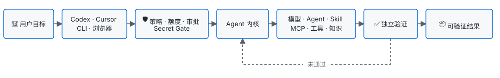

<div align="center">
  <h1>九门赛博提督</h1>
  <p><strong>面向全领域场景的智能协作中枢</strong></p>
  <p>用一个目标，调度模型、Agent、Skill、MCP、工具、知识与专家，交付可验证结果。</p>
  <p>
    <a href="https://www.npmjs.com/package/@skillnull/tidu"></a>
    <a href="https://github.com/skillnull/AI-Tidu9/actions/workflows/quality.yml"></a>
    
    <a href="./LICENSE"></a>
  </p>
  <p>
    <a href="#getting-started">安装与启动</a> ·
    <a href="./docs/EXAMPLES.md">使用实例</a> ·
    <a href="./docs/ARCHITECTURE.md">系统架构</a> ·
    <a href="./docs/CORE-DIFFERENTIATORS.md">核心机制</a> ·
    <a href="./docs/CLI-REFERENCE.md">CLI 参考</a> ·
    <a href="./docs/README.EN.md">English</a>
  </p>
</div>

---

## 🎯 产品定位

九门赛博提督是面向全领域场景的智能协作中枢，以目标驱动内外部 Agent、模型、工具、知识与专家协同执行，交付可验证的业务结果。平台位于用户目标与 AI 能力之间，负责能力组织、执行约束、故障恢复与结果验证。

| 业务问题 | 平台能力 |
| --- | --- |
| 模型额度耗尽，换模型却丢失能力 | 动态回退，必要时仅调用专家模型补齐缺口 |
| Agent、Skill、MCP 和知识分散在不同宿主 | 一个核心、多个入口，按目标装配最小能力集 |
| 自动执行快，但费用、风险和结果不可控 | 预算、审批、策略、检查点和验收条件共同限制执行 |
| 企业想统一治理，个人又需要自主选择 | 强制策略与辅助策略分层，企业和个人资源可并存 |
| 完整会话和工具输出导致存储失控 | 完整历史留在宿主，核心只保留最大 256 KB 的恢复胶囊 |

<a id="getting-started"></a>
## 🚀 安装与首次启动

**需要 Node.js 22.14 或更高版本。** 安装前先确认版本：

```bash
node --version
```

如果版本低于 22.14，可使用已安装的 Node 版本管理器切换。以 NVM 为例：

```bash
nvm install 22
nvm use 22
```

Node 版本满足要求后，安装并启动配置中心：

```bash
npm install -g @skillnull/tidu
tidu setup
tidu start
```

打开终端输出的配置中心。页面会引导完成部署识别、入口命名、模型接入、影响模拟、启用和客户端接入。

> [!NOTE]
> npm 安装命令不会替用户安装或切换 Node.js。请先在当前终端切换到兼容版本，再安装 AI-Tidu9。

服务器无法打开页面时，使用同一套终端向导：

```bash
tidu start --cli
```

已启动后，用两个命令确认状态：

```bash
tidu doctor             # 检查运行时、配置 API 和页面
tidu setup verify       # 验证连接器，不修改配置
```

> [!TIP]
> 所有高级命令都支持 `--help`。完整参数见 [CLI 命令参考](./docs/CLI-REFERENCE.md)。

## 🔄 从目标到可验证结果

<p align="left">
  
</p>

这条链路有三个不可替换的责任：

- **模型做推理**：理解目标、生成计划、评估结果。
- **内核管边界**：执行预算、风险审批、状态转移、失败恢复。
- **证据决定是否完成**：测试通过不代表业务目标已达成，验收条件必须独立判定。

## 🧩 五个核心机制

| 机制 | 作用 | 最重要的边界 |
| --- | --- | --- |
| **多入口、单核心** | Codex、Cursor、CLI 和 OpenAI 兼容客户端共享策略与能力池 | 不读取或复制宿主私有 Token |
| **动态路由** | 按能力、成本、隐私、延迟、可用性和额度选择模型 | 估算成本不冒充供应商账单 |
| **能力补全** | 低成本主模型仅在缺失能力时调用专家模型 | 专家池、次数、费用和隐私边界均必须显式配置 |
| **Runtime Secret Gate** | 出站前识别、阻断或替换敏感信息 | 真实值只在当前任务的私有内存作用域恢复 |
| **可恢复执行** | 任务胶囊、检查点和已验证配置支持恢复与回滚 | 结果不确定时，非幂等操作不自动重放 |

实现细节与可复现案例见 [核心调度与门禁](./docs/CORE-DIFFERENTIATORS.md)。

## 🧭 选择适合你的使用路径

| 我想要…… | 从这里开始 | 数据层 |
| --- | --- | --- |
| 在本机统一个人模型、Skill 和 MCP | `tidu start` | SQLite，默认只监听回环地址 |
| 在服务器集中管理策略、额度和能力 | [远程部署文档](./docs/REMOTE-DEPLOYMENT.md) | 企业控制平面 |
| 保留 IDE 本地能力，同时经过企业出口 | [远程部署文档](./docs/REMOTE-DEPLOYMENT.md) | 服务端状态 + 本地私有边界 |
| 开发模型、Agent、存储或历史 Provider | `@skillnull/tidu/ecosystem` 或 Python SDK | 通过平台 API 访问，不复制控制平面 |

### 配置模型来源

默认自动使用已登录的 Codex 或 Cursor 宿主当前模型，不需要填写模型名或密钥。通过官方宿主进程调用，AI-Tidu9 不读取或复制宿主凭据。下面的命令用于主动覆盖默认模型。

OpenAI 兼容服务：

```bash
TIDU_PROVIDER=openai-compatible \
TIDU_PROVIDER_BASE_URL='https://<service>/v1' \
TIDU_PROVIDER_MODEL=gpt-4.1-mini \
TIDU_PROVIDER_API_KEY='<runtime-key>' \
tidu start
```

本机 Ollama：

```bash
TIDU_PROVIDER=ollama \
TIDU_PROVIDER_MODEL=qwen3:8b \
tidu start
```

> [!IMPORTANT]
> 覆盖服务的密钥只从当前进程环境读取，不进入 SQLite、页面返回或日志。若没有可复用的宿主模型且未设置覆盖供应商，推理会明确返回 `model_provider_not_configured`。

## 🛠️ 运行、诊断与彻底移除

```bash
tidu setup                 # 自动配置九门并按提示重启宿主
tidu clients               # 查看本机客户端兼容情况
tidu account               # 查看可复用的宿主登录状态
tidu channel list          # 查看九门、官方宿主与厂商通道
tidu doctor --json         # 生成不含私密数据的诊断摘要
tidu uninstall             # 清理全部 AI-Tidu9 自有内容
```

完整卸载会保留宿主账号、会话、无关插件、无关配置和自定义数据库路径。

通用客户端通过同一基址使用 `/v1/models`、`/v1/chat/completions` 和 `/v1/responses`；Codex 与 Cursor 等宿主优先使用各自的原生 Agent 或 MCP 连接器，以保留宿主能力边界。
`tidu setup` 会安装 MCP 连接器，并生成一个可回滚的 Codex 九门配置，但不会自动切走官方配置。Codex 中只增加一个九门虚拟模型；配置页列出账号可用的官方模型与公司 Provider 模型，支持选择或填写自定义模型 ID 作为九门上游。公司模型不会成为独立 Codex 模型项。客户端页只切换“九门”和“官方直连”。官方账号、套餐和额度信息仍由官方 Codex 管理。服务页按当前运行形态二选一展示开发服务或本地安装服务，并提供状态刷新与可用操作。九门只保留首次安装基线与最新回滚点两份自有快照。

双通道入口使用 `tidu channel run <channel>`。`tidu` 走九门虚拟模型，`codex` 与 `cursor` 由官方宿主进程执行；CI可使用 `openai`、`deepseek`、`qwen`、`glm`、`kimi`、`doubao`、`hunyuan` 或 `custom` 厂商通道。Codex插件与Cursor通过同一MCP连接器获得 `list_tidu_channels` 和 `route_tidu_channel`，无需替换宿主官方模型列表。

## 🛡️ 信任边界与安全承诺

- 普通草稿、专家草稿和生效快照相互隔离；保存不会自动启用。
- 写入和外部工具默认需要确认；必须策略不能被插件或专家模式绕过。
- 不可信扩展没有外部隔离执行器时默认拒绝；Node `vm` 和普通 Worker 不属于安全沙箱。
- 企业跨设备访问必须使用 HTTPS 反向代理和身份控制，不得直接暴露管理端口。

> [!WARNING]
> 项目已进入实际使用与持续维护。生产关键任务仍应先在目标环境完成容量、权限、安全、升级和回滚验证。

## 📚 文档与学习路径

| 文档 | 回答的问题 |
| --- | --- |
| [系统架构](./docs/ARCHITECTURE.md) | 一次任务如何流动，模块、数据和部署边界在哪里？ |
| [核心调度与门禁](./docs/CORE-DIFFERENTIATORS.md) | 动态路由、能力补全和 Secret Gate 如何工作？ |
| [CLI 命令参考](./docs/CLI-REFERENCE.md) | 如何安装、配置、诊断、恢复和卸载？ |
| [使用实例](./docs/EXAMPLES.md) | 如何完成本地模型、客户端、企业部署和 Provider 接入？ |
| [开放能力生态](./docs/ECOSYSTEM-SDK.md) | 如何安全地接入 Provider 和第三方 Agent？ |
| [Python SDK](./sdk/python/README.md) | 如何从 Python 调用 AI-Tidu9 Provider API？ |
| [贡献指南](./docs/CONTRIBUTING.md) | 分支、提交、版本、维护线和发布规则是什么？ |
| [远程部署](./docs/REMOTE-DEPLOYMENT.md) | 如何部署服务器运行时并隔离跨设备访问？ |
| [本地开发](./docs/LOCAL-DEVELOPMENT.md) | 如何启动、验证并停止仓库开发环境？ |
| [商标与署名](./docs/TRADEMARKS.md) | 修改名称或商业部署时，如何正确说明来源？ |
| [变更记录](./docs/CHANGELOG.md) | 每个已发布版本实际改变了什么？ |

## 🛠️ 本地开发

仓库开发的启动、Codex 配置验收、检查和停止流程统一放在[本地开发文档](./docs/LOCAL-DEVELOPMENT.md)。主文档不混入开发环境操作细节。

## 🤝 问题反馈

问题反馈请附上经审查的 `tidu doctor --json` 输出：

- [提交 Bug 或产品反馈](https://github.com/skillnull/AI-Tidu9/issues/new/choose)
- [私密报告安全漏洞](https://github.com/skillnull/AI-Tidu9/security/advisories/new)

项目使用 [GNU AGPL-3.0-only](./LICENSE)。品牌与署名规则见 [商标政策](./docs/TRADEMARKS.md) 和 [NOTICE](./NOTICE)。
