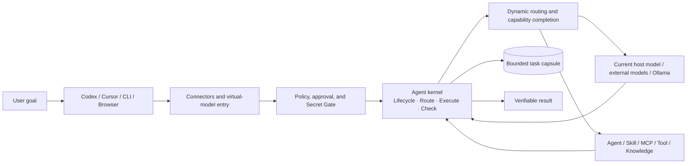
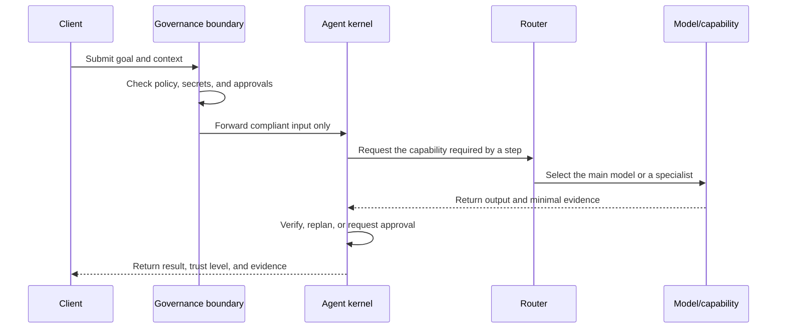
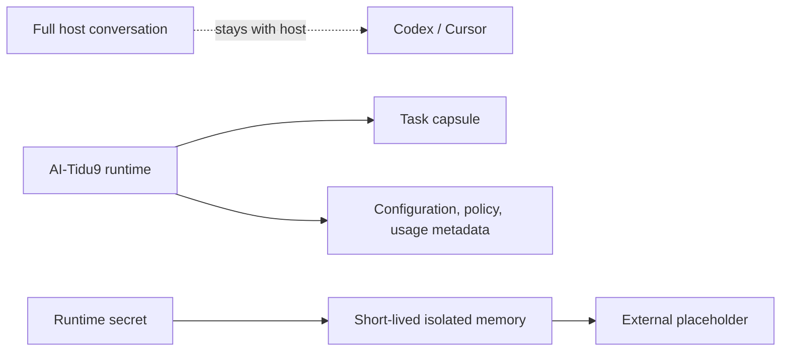

# System Architecture

[README](./README.EN.md) · [Examples](./EXAMPLES.EN.md) · [Core mechanics](./CORE-DIFFERENTIATORS.EN.md) · [CLI](./CLI-REFERENCE.EN.md) · [简体中文](./ARCHITECTURE.md)

AI-Tidu9 uses a modular architecture with one core, multiple entry points, and replaceable adapters. An individual runs one lightweight process. Teams and enterprises can add PostgreSQL, gateways, and workers without changing the core protocol.

## 🧭 Design principles: non-negotiable boundaries

| Principle | Architectural consequence |
| --- | --- |
| **Separate intelligence from control** | Models handle uncertain reasoning; the kernel owns budgets, permissions, state, and acceptance |
| **Separate entry from capability** | Hosts are entry points; models, Agents, Skills, MCP servers, and knowledge share one capability contract |
| **Reuse the current model by default** | Delegate to the signed-in host's current model; only an explicit provider choice overrides it |
| **Bound by default** | Every task has explicit step, time, spend, tool-call, and output-size limits |
| **Minimize state** | Retain recovery capsules and evidence instead of copying full conversations or raw model output |
| **Make failure explicit** | Rejection, degradation, pause, rollback, and recovery are states, not silent fallbacks disguised as success |

## 🗺️ Architecture at a glance

The core does not replace model reasoning or hard-code domain logic. It selects capabilities, limits cost and risk, retains minimal recovery state, and ensures that every request ends in an explicit completed or failed state. The full task flow can also verify business acceptance criteria; ordinary inference performs a response-completeness check only.

Ordinary streaming inference preserves the caller's protocol and the host's native event boundaries. Host adapters dynamically translate public progress, answer, and terminal events from negotiated capabilities and the official events actually received. Unknown new phases fall back to visible output and the host terminal state instead of being blocked by a closed local enum. Generic OpenAI clients receive Responses or Chat Completions events. When a Codex request declares tools, app-server `dynamicTools` produces real calls that are returned to the caller for native execution. Reads, searches, edits, and commands enter the native activity list, including in-progress command state, instead of being flattened into `reasoning`. Reasoning summaries and `commentary` messages retain their types and phases. Waits inject no placeholder progress text. Cancellation is recorded separately and failed terminals retain reported usage. The native client relay reads the official session record to restore cancelled commands, footer tokens, and actual elapsed time in live, reopened, and paginated views. It creates no additional AI-Tidu9 conversation database or copy; reads are capped at the last 8 MiB with a single-file metadata cache. Opt-in regressions exercise real official-host cancellation, process restart, session resume, and rendering with the installed native elapsed-time component. Codex success and returnable failure results include a token footer; missing usage is marked not retrieved and confirmed zero consumption is hidden, and each reported inference round is counted once across tool calls.

Dynamic model routing sits after host entry and before model Providers. Hosts submit both goals and host identity to the same Agent kernel. Each host independently declares a preferred primary, capabilities, cross-host secondary models, capability labels, cost evidence, and per-request limit. A capability assignment may be empty. A zero-capability model does not execute, and an uncovered union of primary and secondary assignments fails closed before any model call. Every secondary must come from another host and execute through that host's Provider; an unavailable target host fails closed without borrowing another host's credentials. Routing first filters by capability, verifiable privacy, and current availability, then compares observed usage with comparable known prices, observed latency, and availability. Capability gaps use bounded composition, a fully capable secondary may execute directly when evidence shows an advantage or the primary owns none of the required capabilities, and `429` or explicit failure triggers fallback among fully capable candidates. Unknown prices and quota data that is not integrated do not drive replacement. History retains only non-secret host and model identifiers, required capabilities, selection reason, outcomes, and timestamps for local, personal, and enterprise status views.

## 🧱 Module map: responsibilities and exclusions

| Area | Code modules | Owns | Does not own |
| --- | --- | --- | --- |
| Entry and host | `cli`, `clients`, `accounts`, `connectors`, `openai` | CLI, client discovery, official account delegation, MCP/ACP, and OpenAI-compatible entry | Never copies host credentials or presents unverified host capabilities |
| Configuration and control | `runtime`, `config`, `config-center` | Service startup, isolated managed/expert drafts, active publication, management API, and UI | Saving a draft never activates it; the UI is not the only control channel |
| Agent kernel | `core`, `protocol`, `agent` | Goals, plans, budgets, approvals, recovery, evidence, and acceptance | Provider-private messages never become core state |
| Models and capabilities | `routing`, `providers`, `capabilities`, `ecosystem`, `usage` | Use the current model through Codex app-server or Cursor ACP by default; allow Ollama and OpenAI-compatible provider overrides | Never reads or copies host credentials; estimated cost never impersonates provider billing |
| Security and organization | `security`, `enterprise` | Runtime redaction, organization policy, roles, quota pools, and administrator access | Plugins and expert settings cannot bypass mandatory policy |
| State and scaling | `storage`, `scaling` | SQLite/PostgreSQL adapters, task capsules, admission, leases, workers, and recovery | Never stores full conversations, raw model responses, or large tool output |

Every module belongs to the single public package `@skillnull/tidu`. Directories preserve internal boundaries; they are not separate npm packages to install.

## 🔄 Task flow: fast inference and full tasks

Ordinary `/v1/chat/completions` and `/v1/responses` requests call the selected model once by default. They perform policy and capability checks, record the execution lifecycle, and check response completeness. A streaming Responses request preserves the native reasoning and message phases, with text-free protocol heartbeats during waits. Model execution has no AI-Tidu9-local deadline and waits for the official host to report completion, failure, or cancellation. If a secondary responsible for a required capability officially fails or is cancelled, the whole request fails closed instead of presenting an incapable primary as successful. Failures contain visible error text and an explicit failed terminal event. Execution records keep the configured model separate from the host-confirmed model. Goal decomposition, checkpoints, tool approval, and independent business acceptance belong to the full task flow:

Tasks use append-only events and monotonically increasing revisions. Write or external tools require approval by default. Non-idempotent work is not replayed after an uncertain interruption. A task capsule is capped at 256 KB and retains only its plan, checkpoint, bounded summaries, budget, and minimal evidence.

### Failure semantics

| Event | Default action | Reason |
| --- | --- | --- |
| Required capability is unavailable | Reject before execution | Never let a model pretend it has a capability |
| Main model returns `429` | Mark it unavailable in the current process and reroute | Preserve continuity without hiding the switch |
| Specialist fails | Try the next eligible candidate within budget, otherwise fail closed | Capability completion cannot exceed spend or call bounds |
| Non-idempotent result is uncertain | Pause for human review | Prevent duplicate charges, sends, or writes |
| New configuration fails its health check | Restore the previous known-good snapshot | Keep configuration changes reversible |
| Worker lease expires | Reassign from the latest checkpoint | Recover work without copying full context |

## 🏗️ Deployment: individual, team, and enterprise

```mermaid
flowchart TB
  subgraph Personal[Personal local]
    PClient[Local clients] --> PCore[Single-process core]
    PCore --> SQLite[(SQLite)]
  end
  subgraph Central[Central enterprise]
    EClient[Employee clients] --> Gateway[HTTPS enterprise gateway]
    Gateway --> Control[Policy / quota / capability catalog]
    Control --> Postgres[(PostgreSQL)]
  end
  subgraph Hybrid[Hybrid enterprise]
    HClient[IDE and local files] --> LocalGate[Lightweight local connector and redaction]
    LocalGate --> HGateway[Enterprise gateway]
    HGateway --> Workers[Scalable workers]
  end
```

- **Personal local:** listens on `127.0.0.1`, uses SQLite, and requires neither Docker nor an external database.
- **Central enterprise:** ordinary OpenAI-compatible clients need no local installation; the gateway owns purchased quota, policy, and server capabilities.
- **Hybrid enterprise:** install a lightweight device connector when IDE context, local Skills/MCP servers, or redaction before egress is required.

Gateways can scale statelessly and workers can scale horizontally. The Scheduler remains one logical writer. Scheduler high availability, leader election, and target-production capacity acceptance are still pending.

### Technology choices and boundaries

| Choice | Why it is used | When not to keep using it |
| --- | --- | --- |
| **Node.js + TypeScript** | One type system spans CLI, HTTP, Agent kernel, connectors, and the React configuration center | Third-party capabilities should integrate through protocols or SDKs instead of being rewritten in Node |
| **SQLite** | Zero external dependencies for personal mode, one file, WAL concurrency, and low operational cost | Move to PostgreSQL for multi-instance writes, enterprise concurrency, and centralized governance |
| **PostgreSQL** | Enterprise scopes, transactions, quota reconciliation, CAS task state, and horizontal scale | Personal local mode should not inherit this deployment burden by default |
| **React + Vite** | Independently built configuration center with fast iteration and shared TypeScript contracts | The page is only one management channel; servers retain an equivalent CLI path |
| **Python SDK** | Gives the Python ecosystem a zero-runtime-dependency platform API client | Never duplicate storage, policy, or scheduling control planes in Python |

## 💾 Data boundary: retained and excluded state

AI-Tidu9 retains only the data required for its own operation. Full conversations can stay with the host or use explicitly bounded local history. Keys, tokens, passwords, raw model responses, and large tool output never enter task storage.

## 🔌 Client compatibility matrix

| Client | Preferred entry | Capability owner | Current boundary |
| --- | --- | --- | --- |
| Codex app, CLI, and IDE | Native exclusive modes + Responses | Official Codex account, session, and permissions | AI-Tidu9 mode exposes only the AI-Tidu9 Agent; Official mode fully restores direct official access |
| Cursor Desktop and Agent CLI | Host connector; authorized CLI through ACP | Cursor host and CLI account | Goals enter the same Agent kernel; desktop login cannot be copied into CLI credentials |
| Generic OpenAI client | `/v1/models`, Chat Completions, Responses | AI-Tidu9 model pool and Agent kernel | Client-specific extensions require separate verification |
| Browser | Configuration center or enterprise gateway | AI-Tidu9 runtime | Cross-device access requires HTTPS and identity control |
| Ollama | Upstream model adapter | Local model | It is a provider, not a host client |

The Codex host bridge uses the official app-server `text`, `image`, and `localImage` inputs plus native host tool events. It publishes text, structured output, reasoning, code, vision, tool use, long context, and web research. Conversation history is injected as official Responses items instead of being serialized into a custom text prompt. Other host bridges such as Cursor continue to publish only capabilities verified through their current protocols.

## 🛡️ Architecture invariants

1. Every model and tool egress crosses the same policy and Secret Gate.
2. Managed drafts, expert drafts, and the active snapshot are isolated; saving never activates.
3. One runtime owns SQLite writes; cross-language SDKs use platform APIs.
4. Extensions pass protocol, integrity, signature, and permission checks first. Untrusted extensions fail closed without an external sandbox.
5. Configuration and protocols are versioned; breaking changes require migration and rollback.

See the [CLI command reference](./CLI-REFERENCE.EN.md) for installation and troubleshooting, and [Core Routing and Secret Gate](./CORE-DIFFERENTIATORS.EN.md) for routing details.
