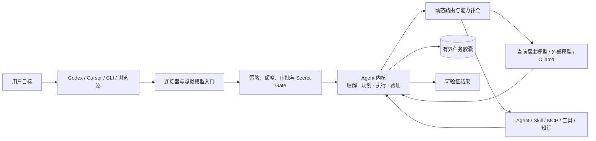
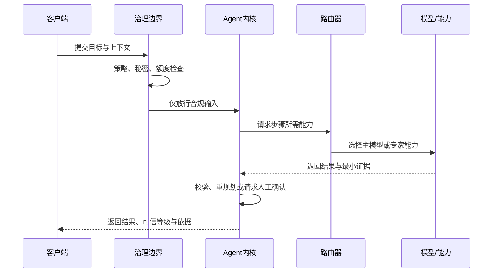
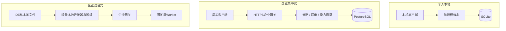
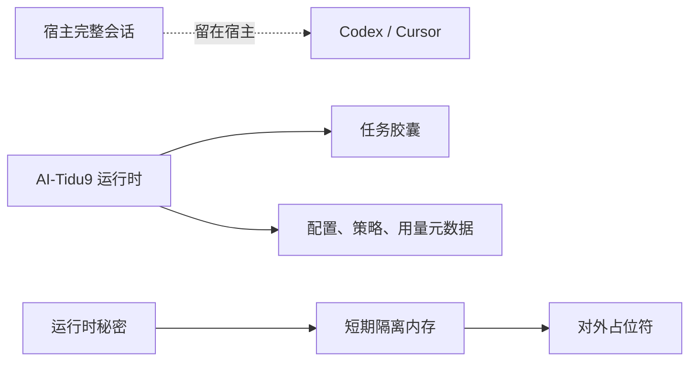

# 系统架构

[README](../README.md) · [使用实例](./EXAMPLES.md) · [核心机制](./CORE-DIFFERENTIATORS.md) · [CLI](./CLI-REFERENCE.md) · [English](./ARCHITECTURE.EN.md)

九门赛博提督采用“一个核心、多个入口、适配器可替换”的模块化架构。个人用户运行一个轻量进程；团队和企业在不改变核心协议的前提下，按需启用PostgreSQL、网关和Worker。

## 🧭 设计准则：先确定不可妥协的边界

| 准则 | 架构结果 |
| --- | --- |
| **智能与控制分离** | 模型处理不确定推理；内核处理预算、权限、状态和验收 |
| **接入与能力分离** | 宿主只是入口；模型、Agent、Skill、MCP 和知识通过统一能力契约装配 |
| **默认复用当前模型** | 默认委托给已登录宿主的当前模型；用户显式选择其他供应商时才覆盖 |
| **默认有界** | 每个任务都有步数、时间、费用、工具调用和输出大小上限 |
| **状态最小化** | 保存恢复所需的胶囊和证据，不复制完整会话或原始模型输出 |
| **失败必须可解释** | 拒绝、降级、暂停、回滚和恢复都是显式状态，不用隐式兜底伪装成功 |

## 🗺️ 架构全景：一张图看懂

核心不替模型思考，也不把领域规则写死。它负责选择能力、限制成本与风险、保存最小恢复状态，并验证结果是否满足目标。

能力互补策略位于宿主入口之后、模型 Provider 之前。宿主把目标和宿主标识送入同一 Agent 内核；每个宿主独立声明主模型、主模型能力、跨宿主副模型、能力标签、价格证据与单次调用上限。入口宿主固定为主模型来源，副模型必须来自其他宿主并由对应 Provider 执行；目标宿主不可用时失败关闭，不回落到主宿主。路由只调用能补齐缺口的副模型，并在价格已知时优先低成本组合。记录只保存非敏感的宿主、模型标识、所需能力、补位结果和时间，用于本地、个人及企业状态页审计。

## 🧱 模块地图：职责与非职责

| 区域 | 代码模块 | 负责什么 | 不负责什么 |
| --- | --- | --- | --- |
| 入口与宿主 | `cli`、`clients`、`accounts`、`connectors`、`openai` | 命令行、客户端发现、官方账号委托、MCP/ACP和OpenAI兼容入口 | 不复制宿主凭据，不伪装未验证的宿主能力 |
| 配置与控制 | `runtime`、`config`、`config-center` | 启动服务、隔离普通/专家草稿、发布生效配置、提供管理API与页面 | 草稿保存不等于启用，页面不是唯一管理通道 |
| Agent内核 | `core`、`protocol`、`agent` | 目标、计划、预算、审批、恢复、证据和验收 | 不把供应商私有消息当作核心状态 |
| 模型与能力 | `routing`、`providers`、`capabilities`、`ecosystem`、`usage` | 默认通过 Codex app-server 或 Cursor ACP 使用当前模型；支持 Ollama 与 OpenAI 兼容服务覆盖 | 不读取或复制宿主凭据；估算费用不冒充供应商账单 |
| 安全与组织 | `security`、`enterprise` | 运行时脱敏、组织策略、角色、额度池和管理员访问边界 | 插件和专家配置不能绕过强制策略 |
| 状态与伸缩 | `storage`、`scaling` | SQLite/PostgreSQL适配、任务胶囊、准入、租约、Worker和恢复 | 不保存完整会话、原始模型响应或大块工具输出 |

所有模块都属于一个公开包 `@skillnull/tidu`。目录用于保持边界，不是需要分别安装的npm包。

## 🔄 任务流：从目标到验收

任务使用追加式事件和单调递增修订号。写入或外部工具默认需要确认；非幂等操作在结果不确定时不会自动重放。单个任务胶囊上限256 KB，只保留恢复所需的计划、检查点、有界摘要、预算和最小证据。

### 失败语义

| 事件 | 默认动作 | 为什么 |
| --- | --- | --- |
| 必需能力不可用 | 执行前拒绝 | 不让模型伪装具备能力 |
| 主模型返回 `429` | 标记当前进程额度耗尽，重新路由 | 保持任务连续性，不隐藏切换原因 |
| 专家能力失败 | 在剩余预算内选下一候选，否则失败关闭 | 能力补全不得突破成本和次数上限 |
| 非幂等操作结果不确定 | 暂停并请求人工判断 | 避免重复扣款、发送或写入 |
| 新配置健康检查失败 | 恢复上一个已验证快照 | 保证配置切换可逆 |
| Worker 租约过期 | 从最新检查点重新分配 | 恢复工作而不复制完整上下文 |

## 🏗️ 部署模型：个人、团队与企业

- **个人本地**：默认监听 `127.0.0.1`，使用SQLite，不要求Docker或外部数据库。
- **企业集中式**：普通OpenAI兼容客户端无需本地安装；企业网关统一管理采购额度、策略和服务端能力。
- **企业混合式**：需要IDE上下文、本地Skill/MCP或出站前脱敏时，在员工设备安装轻量连接器。

Gateway可无状态扩展，Worker可水平扩展；Scheduler仍是单一逻辑写入者。Scheduler高可用、领导者选举和目标生产环境容量验收仍待完成。

### 技术选型与使用边界

| 选型 | 为什么使用 | 何时不应继续使用 |
| --- | --- | --- |
| **Node.js + TypeScript** | 一套类型贯通 CLI、HTTP、Agent 内核、连接器和 React 配置中心 | 第三方能力无需重写为 Node，应通过协议或 SDK 接入 |
| **SQLite** | 个人版零外部依赖、单文件、WAL 并发与低运维成本 | 多实例写入、企业级并发和集中治理转向 PostgreSQL |
| **PostgreSQL** | 企业范围、事务、并发对账、CAS 任务状态和水平扩展 | 个人本地默认不要为此增加部署负担 |
| **React + Vite** | 配置中心可独立构建、快速迭代，并复用 TypeScript 契约 | 页面只是管理通道，服务器环境始终保留等价 CLI |
| **Python SDK** | 让 Python 生态通过平台 API 接入，同时保持零运行时依赖 | 不在 Python 端复制存储、策略或调度控制平面 |

## 💾 数据边界：保存什么，不保存什么

AI-Tidu9 只保存自身运行必需的数据。完整会话可留在宿主，或由用户选择有容量和时间上限的本地历史；密钥、Token、密码、原始模型响应和大块工具输出不得进入任务存储。

## 🔌 客户端兼容：入口能力矩阵

| 客户端 | 首选入口 | 能力归属 | 当前边界 |
| --- | --- | --- | --- |
| Codex应用、CLI、IDE | 原生互斥模式 + Responses | Codex官方账号、会话与权限 | 九门模式只显示九门Agent；官方模式完整恢复官方直连 |
| Cursor桌面端、Agent CLI | 宿主连接器；已授权CLI使用ACP | Cursor宿主与CLI账号 | 目标进入同一Agent内核；桌面登录不能复制为CLI凭据 |
| 通用OpenAI客户端 | `/v1/models`、Chat Completions、Responses | AI-Tidu9 模型池与Agent内核 | 客户端专有能力需单独验证 |
| 浏览器 | 配置中心或企业网关 | AI-Tidu9 运行时 | 跨设备必须使用HTTPS与身份控制 |
| Ollama | 上游模型适配器 | 本地模型 | 它是供应商，不是宿主客户端 |

## 🛡️ 架构红线：不可破坏的约束

1. 所有模型和工具出口经过同一策略与Secret Gate。
2. 普通草稿、专家草稿、生效快照互相隔离；保存不自动启用。
3. SQLite只有一个运行时写入者；跨语言SDK通过平台API访问。
4. 扩展先校验协议、完整性、签名和权限；不可信扩展没有外部沙箱时失败关闭。
5. 配置和协议均有版本；破坏性变更必须提供迁移与回滚。

安装、命令和故障处理见[CLI命令参考](./CLI-REFERENCE.md)，动态路由细节见[核心调度与门禁](./CORE-DIFFERENTIATORS.md)。
