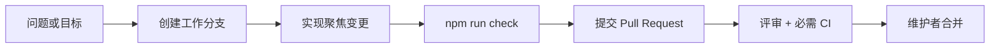
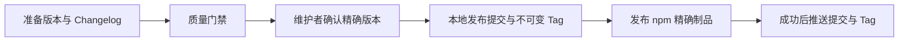

# 贡献指南

[README](../README.md) · [系统架构](./ARCHITECTURE.md) · [CLI 参考](./CLI-REFERENCE.md) · [English](./CONTRIBUTING.EN.md)

感谢你帮助九门赛博提督变得更可靠。这里欢迎代码、测试、文档、兼容性验证和可复现的问题报告。每一次变更都应回答三个问题：**解决什么、如何证明、失败后如何恢复。**

## 🚀 最短贡献路径



```bash
npm run tidu:setup
npm run check
```

## ♻️ 本地开发流程

开发环境的唯一操作说明见[本地开发文档](./LOCAL-DEVELOPMENT.md)。贡献指南只规定协作与质量规则，不重复维护启动、配置和停止步骤。

> [!IMPORTANT]
> `main` 和 `support/*` 是受保护发布线。只有仓库所有者 `@skillnull` 可以更新或合并；其他贡献者必须通过 Pull Request 参与，且不能自行合并。

## 🌿 选择正确的分支

工作分支使用 `<type>/[<issue>-]<kebab-description>`：

```text
feat/123-model-routing
fix/quota-settlement
docs/provider-guide
security/secret-redaction
```

允许的类型：`feat`、`fix`、`docs`、`refactor`、`perf`、`test`、`build`、`ci`、`chore`、`security`。

| 发布线 | 接受的变更 | 不接受的变更 |
| --- | --- | --- |
| `main` | 面向未来的功能、架构、修复和维护 | 历史兼容代码的机械合并 |
| `support/<major>.x` | 缺陷、安全、文档、测试、构建、CI和维护 | 新功能、大范围重构、架构演进 |

- 不使用 `develop` 或 `release/*`；`main` 是唯一面向未来的集成主干。
- 仅当 `main` 进入下一不兼容 Major，且旧 Major 有明确维护承诺时，才从旧版最终 Tag 创建 `support/<major>.x`。
- 同一 Major 只能由 `main` 或对应 `support` 唯一持有，最多保留两条活跃维护线。
- 受保护发布线不能相互合并。适用修复通过聚焦的 Backport 或 Forward-port PR 同步。
- 工作分支使用小写，不超过 80 个字符，合并后删除。禁止强推和改写受保护历史。

验证分支名：

```bash
npm run policy -- branch
```

## 🎯 保持变更可评审

一份优秀的 PR 应该足够小，能让评审者在一次阅读中建立完整因果关系。

| 必须说明 | 期望证据 |
| --- | --- |
| 问题与用户影响 | Issue、复现步骤或明确目标 |
| 方案与边界 | 为什么在这一层解决，哪些内容刻意不改 |
| 验证 | 自动化命令和真实场景结果 |
| 兼容性 | Node、协议、客户端、数据与公开 API 影响 |
| 风险与恢复 | 安全、隐私、成本、资源、迁移和回滚方式 |
| 文档 | 面向用户的中英文内容同步更新 |

新增依赖、公开 API、协议、数据保留规则或策略绕过能力，需要明确的设计依据。生成文件必须可复现；大型二进制和内置第三方依赖需要维护者批准。

## ✍️ 提交与 PR 标题

提交标题和 PR 标题遵循 Conventional Commits：

```text
type(scope)!: imperative description
```

示例：

```text
feat(routing): add bounded specialist fallback
fix(storage): reject stale task revisions
docs(sdk): clarify provider trust levels
```

- 标题不超过 100 个字符，不以句号结尾。
- 不兼容变更使用 `!`，并在正文增加 `BREAKING CHANGE:`。
- 每个提交保持聚焦；合并前清理 fixup，优先使用 Squash Merge 和线性历史。
- 作者不能批准自己的 PR；合并前至少需要一名非作者批准和全部必需 CI。

验证标题：

```bash
npm run policy -- commit "feat(scope): description"
```

## ✅ 质量与安全门禁

提交前运行：

```bash
npm run check
```

该命令验证版本策略、代码规范、Node 测试、工作区测试和 Python SDK 测试。测试通过只是底线；涉及客户端、数据库、网络或升级路径时，还应记录真实环境验证。

以下内容不得进入仓库：

- 密钥、Token、密码、证书和生成凭据；
- 个人数据、本机私有路径、账号标识和内部域名；
- 企业机密、真实会话正文和未脱敏诊断信息；
- 无法复现的生成文件或未经批准的大型二进制。

安全漏洞不得提交公开 Issue，请使用 [GitHub Private Vulnerability Reporting](https://github.com/skillnull/AI-Tidu9/security/advisories/new)。任何变更都不得削弱强制策略、额度、审批、Secret Gate 或独立验收。

## 📦 版本与发布

版本遵循 SemVer，预发布标识仅允许 `alpha.N`、`beta.N` 和 `rc.N`，Git Tag 使用 `v<version>`。



- 私有根工作区不持有发布版本；每个公开包独立持有并同步内部引用。
- 本库工作区不提交依赖锁文件。直接开发依赖保持精确版本，CI 每次解析全新依赖树。
- 发布只来自与包版本一致的不可变 Tag，不能直接从可变分支发布。
- 同一 Commit 只构建一次；已验证制品在发布渠道间晋级，不重复构建。
- 首个稳定版之前，最新公开预发布同时更新所属渠道和 `latest`；稳定版之后，只有稳定版本更新 `latest`。
- 发布入口是 `npm run publish:tidu`。它准备版本和 Changelog、展示摘要并要求输入完整版本号确认。
- `npm run publish:tidu -- --dry-run` 只验证已准备版本，不写入、不打 Tag、不发布。
- 未经维护者明确确认，禁止提交发布变更、推送、打 Tag 或发布 npm。

稳定版以证据判定，而不是以热度判定。公开观察期至少 14 天；所有可处理反馈必须修复、记录为已接受风险，或以无法复现关闭。零反馈不会无限延长观察期，但缺少质量、真实试用、升级回滚、安全评审或兼容性证据会阻断稳定版。

## 🔒 仓库保护模型

远端 Ruleset `Protect release lines — owner only` 同时保护 `main` 与 `support/*`，仅允许 `@skillnull` 绕过，并要求稳定的 `Policy` 与 `Verify` 检查。本地 Git Hooks 只提供提前反馈；远端 Ruleset 和必需 CI 才是最终门禁。

参考规范：[Semantic Versioning](https://semver.org/) · [Conventional Commits](https://www.conventionalcommits.org/)
