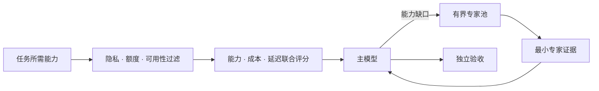
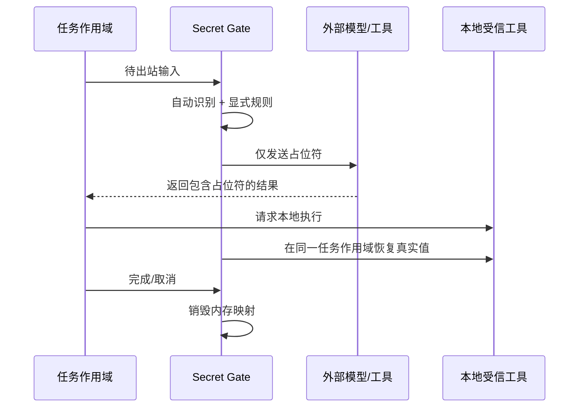

# 核心调度与门禁

[README](../README.md) · [使用实例](./EXAMPLES.md) · [系统架构](./ARCHITECTURE.md) · [CLI](./CLI-REFERENCE.md) · [English](./CORE-DIFFERENTIATORS.EN.md)

AI-Tidu9 的核心价值不是“再调一次模型”，而是在每次调用前后回答四个工程问题：**谁来做、缺什么、什么不能出去、什么证明已完成。**



## 🔎 先过滤，再评分

`createDynamicModelRouter(models, policy)` 接收模型适配器和非敏感元数据。路由不会直接在所有模型中选“分数最高”，而是先排除不合格候选：

1. 从协议、工具、结构化输出、图像输入和调用方约束推导必需能力。
2. 排除已停用、额度耗尽、协议不匹配或突破隐私边界的模型。
3. 对剩余候选联合评估能力、成本、隐私、延迟和可用性。
4. 优先使用显式配置的主模型；返回 `429` 后，只在当前进程将其标记为额度耗尽并重新路由。

这个顺序很重要：隐私和必需能力是准入条件，不是可以被低价或低延迟抵消的权重。

## 🧩 能力补全只填缺口

能力补全默认不隐式开启。用户必须明确设置：

- `capabilityCompletion.enabled`；
- 允许进入专家池的模型 ID；
- 单次任务可调用的最大专家数；
- 任务级费用、时间、隐私和输出大小上限。

专家模型不接管完整会话。它只获取完成缺失能力所需的最小输入，返回有界证据，再由主模型组织最终结果。免费模型和 Ollama 等本地模型可用零成本及 `local` 隐私元数据进入同一评分体系。

## 🧰 能力资产按需装配

`createCapabilityRegistry` 用一套契约描述 Agent、Skill、MCP、工具和知识。内核在理解目标后，根据能力覆盖、成本和隐私边界选择最小集合。

| 阶段 | 允许的动作 | 禁止的动作 |
| --- | --- | --- |
| 发现 | 读取有界元数据 | 执行扩展、跟随符号链接、扫描未授权根目录 |
| 选择 | 比较能力、权限、成本和信任等级 | 为了“尽量完成”而忽略必需能力 |
| 执行 | 在已授权、有界作用域中调用 | 越过强制策略或扩大权限 |
| 记录 | 保留最小证据和使用元数据 | 写入完整会话、原始模型响应或大块工具输出 |

## 🔐 Secret Gate 只在真正出站边界恢复



默认检测包括私钥、Bearer Token、JWT、常见供应商密钥、AWS Access Key 和敏感字段。用户或组织可增加显式正则，并选择阻断或本地替换。每个任务使用独立、有容量和生命周期上限的内存作用域；真实值不写入 SQLite。

> [!WARNING]
> 自动检测是纵深防御，不是“识别世界上所有未知秘密”的承诺。高敏环境仍需显式规则、网络出口、供应商合同和终端管理共同约束。绕过 AI-Tidu9 运行时直接访问网络的自定义代码，不在门禁控制范围内。

## 📊 可复现的成本与能力证据

仓库测试 `routing/index.test.ts` 执行一条真实路由链：低成本主模型处理文本和结构化输出，视觉专家只补齐图像能力，专家证据回注后再由主模型生成最终结果。

| 路由 | 配置单价（输入+输出，每百万 Token） | 调用数 | 能力 |
| --- | ---: | ---: | --- |
| 低成本主模型 | 0.30 | 1 | 文本、结构化输出 |
| 视觉专家 | 0.30 | 1 | 文本、视觉 |
| **组合结果** | **0.60** | **2** | **文本、结构化输出、视觉** |

同一测试还验证了：专家池必须显式选择；主模型确实收到专家证据；隐私约束会排除外部模型；零成本本地模型可被选择；主模型 `429` 后可回退。`0.60` 是按配置价格得出的路由估算，不是供应商账单。

## ⚙️ 最小可用配置

```ts
const router = createDynamicModelRouter(
  [cheapMain, visionSpecialist, localFallback],
  {
    enabled: true,
    mainModelId: "cheap-main",
    weights: { capability: 5, cost: 3, privacy: 2, latency: 1, availability: 2 },
    capabilityCompletion: {
      enabled: true,
      poolModelIds: ["vision-specialist", "local-fallback"],
      maximumSpecialists: 2,
    },
  },
);

await startLocalRuntime({ provider: router });
```

配置只保存模型 ID 和非敏感路由元数据。供应商凭据由适配器在运行时持有，不进入路由决策、诊断信息或任务胶囊。
