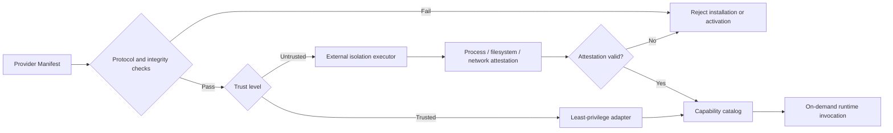

# Open Capability Ecosystem

[README](./README.EN.md) · [Provider example](./EXAMPLES.EN.md#example-provider-sdk) · [Architecture](./ARCHITECTURE.EN.md) · [CLI Reference](./CLI-REFERENCE.EN.md) · [简体中文](./ECOSYSTEM-SDK.md)

> **One protocol for models, Agents, clients, storage, and history.**
>
> Capability Provider Protocol keeps AI-Tidu9 open to future capabilities while preserving one verifiable boundary for permissions, trust, and compatibility.

## 🔄 From declaration to safe execution



Discovery is not execution, installation is not authorization, and declaring a capability does not grant unlimited permission. Keeping these stages separate prevents a growing extension ecosystem from erasing runtime boundaries.

## 🧩 Five provider kinds, one contract

| Kind | Responsibility | Must not do |
| --- | --- | --- |
| Model | Inference, generation, structured output, and capability probing | Bypass routing, cost, or data policy |
| Agent | Accept bounded delegation and return results with evidence | Recurse indefinitely, call unlimited tools, or take over the control plane |
| Client | Map a host entry point to the AI-Tidu9 protocol | Copy host credentials or silently alter host conversations |
| Storage | Persist AI-Tidu9 state, indexes, and audit summaries | Own complete conversation bodies by default |
| History | Associate host history under explicit authorization | Treat history as an unbounded knowledge source |

## 📄 Minimal Provider Manifest

The TypeScript SDK ships with `@skillnull/tidu` and is imported from `@skillnull/tidu/ecosystem`. A manifest declares a stable identity, SemVer version, protocol version, kind, capabilities, least-privilege permissions, source, and trust level:

```ts
import type { CapabilityProviderManifest } from "@skillnull/tidu/ecosystem";

export const provider = {
  id: "com.example.vision",
  name: "Vision Specialist",
  version: "1.0.0",
  protocolVersion: "1.0.0",
  kind: "model",
  source: "local",
  capabilities: ["vision.describe"],
  permissions: ["model.invoke"],
  trust: "trusted",
} satisfies CapabilityProviderManifest;
```

Optional SHA-256 integrity, Ed25519 signatures, and dependency constraints are verified before installation or activation. Enterprise-private, local, and official catalogs can coexist; resolution prefers enterprise, then local, then official unless callers provide another explicit order.

## 🛡️ Trust is not a boolean

| Level | Execution path | Default behavior |
| --- | --- | --- |
| Trusted provider | Still constrained by least privilege | Expose only declared and approved capabilities |
| Untrusted provider | Must cross an external isolation executor | Deny execution without compliant isolation and valid attestation |
| Discovery-only resource | Read bounded metadata only | Never load code, start processes, or initiate network access |

Skill and MCP discovery reads only `SKILL.md`, `mcp.json`, and `.mcp.json` under explicit roots. Traversal is depth- and entry-bounded, does not follow symbolic links, and never executes extensions during discovery. Node `vm` and ordinary Workers are not security sandboxes.

Third-party Agent delegation requires `agent.delegate` and immutable bounds for turns, tool calls, time, and output size. Extension authors can use `testCapabilityProvider` for protocol, integrity, and smoke checks; a complete example lives at `packages/tidu/src/ecosystem/example-provider.ts`.

The zero-runtime-dependency [Python SDK](../sdk/python/README.EN.md) lives in `sdk/python` and uses AI-Tidu9 platform APIs instead of duplicating the TypeScript control plane. Node and Python ecosystems therefore share one protocol and governance model rather than maintaining two drifting kernels.

## 🔁 Compatibility and migration policy

- Protocol versions follow SemVer: patches contain compatible fixes, minors add only optional fields or capabilities, and breaking changes require a major version.
- SDKs remain source-compatible within a protocol major. Deprecations span at least one minor release and include a replacement API, migration example, and rollback guidance.
- Providers declare their protocol version. Runtimes fail closed on an unknown major instead of guessing compatibility.
- New manifest fields are optional by default. Security-semantic changes never silently downgrade and require a new protocol version or explicit capability negotiation.
- Before an API is removed, official adapters, TypeScript SDK, Python SDK, testing tools, and documentation migrate in the same release.
