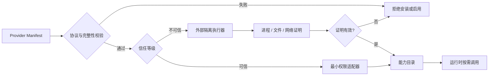

# 开放能力生态

[README](../README.md) · [Provider 实例](./EXAMPLES.md#example-provider-sdk) · [系统架构](./ARCHITECTURE.md) · [CLI 参考](./CLI-REFERENCE.md) · [English](./ECOSYSTEM-SDK.EN.md)

> **一个协议，连接模型、Agent、客户端、存储与历史。**
>
> Capability Provider Protocol 让九门赛博提督可以持续接入新能力，同时把权限、信任和兼容性留在同一条可验证边界内。

## 🔄 从能力声明到安全执行



发现不等于执行，安装不等于授权，声明能力也不等于获得无限权限。协议把这三件事拆开，避免插件生态越丰富，运行边界反而越模糊。

## 🧩 五类 Provider，一套契约

| 类型 | 负责什么 | 不应该负责什么 |
| --- | --- | --- |
| Model | 推理、生成、结构化输出与能力探测 | 绕过路由、费用或数据策略 |
| Agent | 接受受限委派并返回结果与证据 | 无限递归、无限工具调用或接管控制平面 |
| Client | 把宿主入口映射到 AI-Tidu9 协议 | 复制宿主凭据或私自改变宿主会话 |
| Storage | 保存 AI-Tidu9 自身状态、索引和审计摘要 | 默认接管完整会话正文 |
| History | 在明确授权下关联宿主历史能力 | 把历史当作无边界知识源 |

## 📄 最小 Provider Manifest

TypeScript SDK 随 `@skillnull/tidu` 发布，从 `@skillnull/tidu/ecosystem` 导入。Provider Manifest 至少声明稳定标识、SemVer 版本、协议版本、类型、能力、最小权限、来源与信任等级：

```ts
import type { CapabilityProviderManifest } from "@skillnull/tidu/ecosystem";

export const provider = {
  id: "com.example.vision",
  name: "Vision Specialist",
  version: "1.0.0",
  protocolVersion: "1.0.0",
  kind: "model",
  source: "local",
  capabilities: ["vision.describe"],
  permissions: ["model.invoke"],
  trust: "trusted",
} satisfies CapabilityProviderManifest;
```

可选的 SHA-256 完整性、Ed25519 签名与依赖约束会在安装或启用前验证。企业私有、本地和官方目录可以并存；默认解析顺序为企业私有、本地、官方，调用方也可以显式覆盖。

## 🛡️ 信任不是布尔值

| 等级 | 执行方式 | 默认行为 |
| --- | --- | --- |
| 可信 Provider | 仍受最小权限约束 | 只开放 Manifest 声明且获批的能力 |
| 不可信 Provider | 必须经过外部隔离执行器 | 无合规隔离器或证明无效时拒绝执行 |
| 仅发现资源 | 只读取受限元数据 | 不加载代码、不启动进程、不发起网络请求 |

Skill 与 MCP 发现只读取显式根目录内的 `SKILL.md`、`mcp.json` 或 `.mcp.json` 元数据，受深度和条目数限制，不跟随符号链接，也不会在发现阶段执行扩展。Node `vm` 或普通 Worker 不被视为安全沙箱。

第三方 Agent 委派需要 `agent.delegate` 权限，并强制限制轮次、工具调用数、时间和输出大小。`testCapabilityProvider` 可供扩展作者执行协议、完整性与冒烟测试；完整示例位于 `packages/tidu/src/ecosystem/example-provider.ts`。

[Python SDK](../sdk/python/README.md) 位于 `sdk/python`，保持零运行时依赖，通过 AI-Tidu9 平台 API 工作，不复制 TypeScript 控制平面。这样 Node 与 Python 生态共享同一协议和治理语义，而不是维护两套互相漂移的内核。

## 🔁 兼容与迁移策略

- 协议版本遵循 SemVer：补丁版本只修复兼容问题，次版本只增加可选字段或能力，主版本才允许破坏性变化。
- SDK 在同一协议主版本内保持源代码兼容；废弃项至少跨越一个次版本，并提供替代 API、迁移示例和回滚方法。
- Provider 必须声明协议版本；运行时对未知主版本失败关闭，不进行猜测性兼容。
- Manifest 新字段默认可选；安全语义变化不得静默降级，必须使用新协议版本或显式能力协商。
- 正式移除 API 前，官方适配器、TypeScript SDK、Python SDK、测试工具和文档必须在同一发布中迁移。
