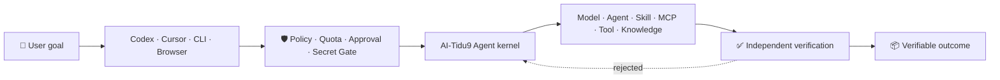

<div align="center">
  <h1>AI-Tidu9</h1>
  <p><strong>An intelligent collaboration hub for every domain</strong></p>
  <p>Start with one goal. Coordinate models, Agents, Skills, MCP servers, tools, knowledge, and experts. Deliver a verifiable outcome.</p>
  <p>
    <a href="https://www.npmjs.com/package/@skillnull/tidu"></a>
    <a href="https://github.com/skillnull/AI-Tidu9/actions/workflows/quality.yml"></a>
    
    <a href="../LICENSE"></a>
  </p>
  <p>
    <a href="#getting-started">Installation and first run</a> ·
    <a href="./EXAMPLES.EN.md">Examples</a> ·
    <a href="./ARCHITECTURE.EN.md">Architecture</a> ·
    <a href="./CORE-DIFFERENTIATORS.EN.md">Core mechanics</a> ·
    <a href="./CLI-REFERENCE.EN.md">CLI reference</a> ·
    <a href="../README.md">简体中文</a>
  </p>
</div>

---

## 🎯 Product positioning

AI-Tidu9 is an intelligent collaboration hub for every domain. It coordinates internal and external Agents, models, tools, knowledge, and experts around a goal to deliver verifiable business outcomes. The platform sits between user intent and AI capabilities to organize execution, enforce boundaries, recover failures, and verify results.

| Business problem | Platform capability |
| --- | --- |
| A model runs out of quota, but its replacement lacks a required capability | Route to a fallback and invoke a specialist only for the missing capability |
| Agents, Skills, MCP servers, and knowledge are scattered across hosts | Keep one core behind multiple entry points and assemble the smallest capability set for each goal |
| Autonomous execution is fast but cost, risk, and completion are unclear | Bound execution with budgets, approvals, policy, checkpoints, and acceptance criteria |
| Enterprise governance conflicts with personal choice | Separate mandatory from advisory policy and allow enterprise and personal resources to coexist |
| Full conversations and tool output make centralized storage unbounded | Keep full history with the host and retain only a recovery capsule capped at 256 KB |

<a id="getting-started"></a>
## 🚀 Installation and first run

**Node.js 22.14 or later is required.** No global installation is needed:

```bash
npx @skillnull/tidu start
```

Open the configuration-center URL printed in the terminal. The guided flow detects the deployment, names the entry, connects a model, previews impact, activates the configuration, and connects supported clients.

When a server has no usable browser, run the same setup in the terminal:

```bash
npx @skillnull/tidu start --cli
```

Verify the running system with two commands:

```bash
tidu doctor             # Check runtime, configuration API, and page
tidu setup verify       # Verify connectors without changing them
```

> [!TIP]
> Every advanced command supports `--help`. See the complete [CLI command reference](./CLI-REFERENCE.EN.md).

## 🔄 From goal to verifiable outcome



This path preserves three separate responsibilities:

- **Models reason:** understand the goal, propose plans, and assess outputs.
- **The kernel controls boundaries:** enforce budgets, approvals, state transitions, and recovery.
- **Evidence decides completion:** passing tests is not the same as satisfying the business goal; acceptance remains an explicit decision.

## 🧩 Five core mechanics

| Mechanic | Purpose | Critical boundary |
| --- | --- | --- |
| **Many entries, one core** | Codex, Cursor, CLI, and OpenAI-compatible clients share policy and capabilities | Never read or copy private host tokens |
| **Dynamic routing** | Select models by capability, cost, privacy, latency, availability, and quota | Estimated cost never impersonates provider billing |
| **Capability completion** | Let a low-cost main model invoke a specialist only for a missing capability | Specialist pool, count, spend, and privacy bounds are explicit |
| **Runtime Secret Gate** | Detect, block, or replace sensitive information before egress | Recover real values only inside the current task's private memory scope |
| **Recoverable execution** | Use task capsules, checkpoints, and known-good configuration for recovery | Never replay uncertain non-idempotent work automatically |

See [Core Routing and Secret Gate](./CORE-DIFFERENTIATORS.EN.md) for implementation details and a reproducible example.

## 🧭 Choose the right path

| I want to… | Start here | State layer |
| --- | --- | --- |
| Unify personal models, Skills, and MCP servers locally | `npx @skillnull/tidu start` | SQLite, loopback-only by default |
| Centralize policy, quota, and capabilities on a server | Docker deployment + PostgreSQL | Enterprise control plane |
| Preserve local IDE capabilities behind enterprise egress controls | Enterprise gateway + device connector | Server state + local private boundary |
| Build a model, Agent, storage, or history provider | `@skillnull/tidu/ecosystem` or Python SDK | Platform APIs, without duplicating the control plane |

<details>
<summary><strong>Enterprise single-host pilot: minimal Docker command</strong></summary>

```bash
TIDU_POSTGRES_PASSWORD='<private-password>' \
docker compose -f config/docker/compose.yml up --build
```

The container binds to server loopback by default. Cross-device access requires an HTTPS reverse proxy and enterprise identity controls; never expose the management port directly.

</details>

### Connect a model source

OpenAI-compatible service:

```bash
TIDU_PROVIDER=openai-compatible \
TIDU_PROVIDER_MODEL=gpt-4.1-mini \
TIDU_PROVIDER_API_KEY='<runtime-key>' \
npx @skillnull/tidu start
```

Local Ollama:

```bash
TIDU_PROVIDER=ollama \
TIDU_PROVIDER_MODEL=qwen3:8b \
npx @skillnull/tidu start
```

> [!IMPORTANT]
> Keys are read only from the current process environment. They never enter SQLite, page responses, or logs. Without a provider, configuration remains available and inference returns `model_provider_not_configured` explicitly.

## 🛠️ Operate, diagnose, and remove completely

```bash
tidu setup                 # Install detected host connectors
tidu clients               # Inspect local client compatibility
tidu account               # Inspect reusable host login state
tidu doctor --json         # Generate a privacy-safe diagnostic summary
tidu uninstall             # Create a recoverable archive
tidu uninstall --complete  # Remove every AI-Tidu9-owned artifact
```

Complete removal preserves host accounts, conversations, unrelated plugins and configuration, and custom database paths.

Generic clients use `/v1/models`, `/v1/chat/completions`, and `/v1/responses` on the same base URL. Hosts such as Codex and Cursor should prefer native Agent or MCP connectors to preserve host capability boundaries.

## 🛡️ Trust boundaries and security promises

- Managed drafts, expert drafts, and the active snapshot are isolated. Saving never activates.
- Write and external tools require approval by default. Plugins and expert settings cannot bypass mandatory policy.
- Untrusted extensions fail closed without an external isolation executor. Node `vm` and ordinary Workers are not security sandboxes.
- Cross-device enterprise access requires an HTTPS reverse proxy and identity control. Never expose the management port directly.

> [!WARNING]
> The project is in real-world use and continuous maintenance. Production-critical workloads still require capacity, permission, security, upgrade, and rollback validation in the target environment.

## 📚 Documentation and learning paths

| Document | Question it answers |
| --- | --- |
| [System Architecture](./ARCHITECTURE.EN.md) | How does a task move, and where are module, data, and deployment boundaries? |
| [Core Routing and Secret Gate](./CORE-DIFFERENTIATORS.EN.md) | How do dynamic routing, capability completion, and Secret Gate work? |
| [CLI command reference](./CLI-REFERENCE.EN.md) | How do I install, configure, diagnose, recover, and uninstall? |
| [Practical examples](./EXAMPLES.EN.md) | How do I connect a local model, client, enterprise pilot, or Provider? |
| [Open capability ecosystem](./ECOSYSTEM-SDK.EN.md) | How do I connect providers and third-party Agents safely? |
| [Python SDK](../sdk/python/README.EN.md) | How do I invoke the AI-Tidu9 Provider API from Python? |
| [Contributing](./CONTRIBUTING.EN.md) | What are the branch, commit, version, maintenance-line, and release rules? |
| [Trademark and attribution](./TRADEMARKS.EN.md) | How do renamed or commercial deployments describe their origin correctly? |
| [Changelog](./CHANGELOG.EN.md) | What changed in each published version? |

## 🤝 Development and feedback

```bash
npm run setup
npm run check
```

Attach a reviewed `tidu doctor --json` report when opening an issue:

- [Report a bug or share product feedback](https://github.com/skillnull/AI-Tidu9/issues/new/choose)
- [Report a vulnerability privately](https://github.com/skillnull/AI-Tidu9/security/advisories/new)

Licensed under [GNU AGPL-3.0-only](../LICENSE). See the [trademark policy](./TRADEMARKS.EN.md) and [NOTICE](../NOTICE) for branding and attribution.
