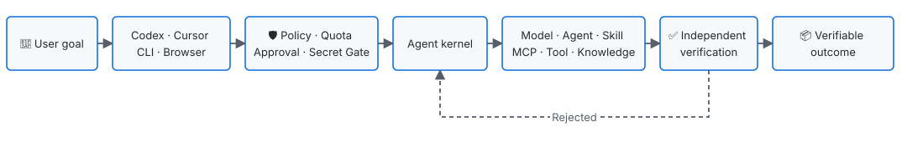

<div align="center">
  <h1>AI-Tidu9</h1>
  <p><strong>An intelligent collaboration hub for every domain</strong></p>
  <p>Start with one goal. Coordinate models, Agents, Skills, MCP servers, tools, knowledge, and experts. Deliver a verifiable outcome.</p>
  <p>
    <a href="https://www.npmjs.com/package/@skillnull/tidu"></a>
    <a href="https://github.com/skillnull/AI-Tidu9/actions/workflows/quality.yml"></a>
    
    <a href="../LICENSE"></a>
  </p>
  <p>
    <a href="#getting-started">Installation and first run</a> ·
    <a href="./EXAMPLES.EN.md">Examples</a> ·
    <a href="./ARCHITECTURE.EN.md">Architecture</a> ·
    <a href="./CORE-DIFFERENTIATORS.EN.md">Core mechanics</a> ·
    <a href="./CLI-REFERENCE.EN.md">CLI reference</a> ·
    <a href="../README.md">简体中文</a>
  </p>
</div>

---

## 🎯 Product positioning

AI-Tidu9 is an intelligent collaboration hub for every domain. It coordinates internal and external Agents, models, tools, knowledge, and experts around a goal to deliver verifiable business outcomes. The platform sits between user intent and AI capabilities to organize execution, enforce boundaries, recover failures, and verify results.

| Business problem | Platform capability |
| --- | --- |
| A model runs out of quota, but its replacement lacks a required capability | Route to a fallback and invoke a specialist only for the missing capability |
| Agents, Skills, MCP servers, and knowledge are scattered across hosts | Keep one core behind multiple entry points and assemble the smallest capability set for each goal |
| Autonomous execution is fast but cost, risk, and completion are unclear | Bound execution with budgets, approvals, policy, checkpoints, and acceptance criteria |
| Enterprise governance conflicts with personal choice | Separate mandatory from advisory policy and allow enterprise and personal resources to coexist |
| Full conversations and tool output make centralized storage unbounded | Keep full history with the host and retain only a recovery capsule capped at 256 KB |

<a id="getting-started"></a>
## 🚀 Installation and first run

**Node.js 22.14 or later is required.** Check the version before installation:

```bash
node --version
```

If the version is older than 22.14, switch with an installed Node version manager. For example, with NVM:

```bash
nvm install 22
nvm use 22
```

After Node meets the requirement, install and start the configuration center:

```bash
npm install -g @skillnull/tidu
tidu setup
tidu start
```

Open the configuration-center URL printed in the terminal. The guided flow detects the deployment, names the entry, connects a model, saves the draft when you click Save and continue, requests activation, and connects supported clients.

> [!NOTE]
> The npm installation command does not install or switch Node.js. Switch the current terminal to a compatible Node version before installing AI-Tidu9.

When a server has no usable browser, run the same setup in the terminal:

```bash
tidu start --cli
```

Verify the running system with two commands:

```bash
tidu doctor             # Check runtime, configuration API, and page
tidu setup verify       # Verify connectors without changing them
```

> [!TIP]
> Every advanced command supports `--help`. See the complete [CLI command reference](./CLI-REFERENCE.EN.md).

## 🔄 From goal to verifiable outcome

<p align="left">
  
</p>

This path preserves three separate responsibilities:

- **Models reason:** understand the goal, propose plans, and assess outputs.
- **The kernel controls boundaries:** enforce budgets, approvals, state transitions, and recovery.
- **Evidence decides completion:** passing tests is not the same as satisfying the business goal; acceptance remains an explicit decision.

## 🧩 Five core mechanics

| Mechanic | Purpose | Critical boundary |
| --- | --- | --- |
| **Many entries, one core** | Codex, Cursor, CLI, and OpenAI-compatible clients share policy and capabilities | Never read or copy private host tokens |
| **Dynamic routing** | Select models by capability, known cost, verifiable privacy, observed latency, availability, and explicit failure signals | Unknown prices and quota data that is not integrated never drive replacement |
| **Cross-model collaboration** | Let configured secondary models participate for capability gaps, lower price-backed token cost, lower latency, higher availability, or failure fallback | Model pool, count, spend, and privacy bounds are explicit |
| **Runtime Secret Gate** | Detect, block, or replace sensitive information before egress | Recover real values only inside the current task's private memory scope |
| **Recoverable execution** | Use task capsules, checkpoints, and known-good configuration for recovery | Never replay uncertain non-idempotent work automatically |

See [Core Routing and Secret Gate](./CORE-DIFFERENTIATORS.EN.md) for implementation details and a reproducible example.

## 🧭 Choose the right path

| I want to… | Start here | State layer |
| --- | --- | --- |
| Unify personal models, Skills, and MCP servers locally | `tidu start` | SQLite, loopback-only by default |
| Centralize policy, quota, and capabilities on a server | [Remote deployment](./REMOTE-DEPLOYMENT.EN.md) | Enterprise control plane |
| Preserve local IDE capabilities behind enterprise egress controls | [Remote deployment](./REMOTE-DEPLOYMENT.EN.md) | Server state + local private boundary |
| Build a model, Agent, storage, or history provider | `@skillnull/tidu/ecosystem` or Python SDK | Platform APIs, without duplicating the control plane |

### Connect a model source

AI-Tidu9 automatically uses the current model from a signed-in Codex or Cursor host. You do not need to enter a model name or key. Calls go through the official host process; AI-Tidu9 never reads or copies host credentials. The commands below explicitly override that default.

The Codex bridge forwards text, remote images, and local images through the official app-server input types and reuses the signed-in account's native reasoning, command, file, search, and tool capabilities. It no longer flattens multimodal input into a custom text prompt or appends an AI-Tidu9 summary to the answer. Other hosts such as Cursor still publish only capabilities verified through their own bridge protocols and fail explicitly for unsupported requests.

OpenAI-compatible service:

```bash
TIDU_PROVIDER=openai-compatible \
TIDU_PROVIDER_BASE_URL='https://<service>/v1' \
TIDU_PROVIDER_MODEL=gpt-4.1-mini \
TIDU_PROVIDER_API_KEY='<runtime-key>' \
tidu start
```

Local Ollama:

```bash
TIDU_PROVIDER=ollama \
TIDU_PROVIDER_MODEL=qwen3:8b \
tidu start
```

> [!IMPORTANT]
> Override-service keys are read only from the current process environment. They never enter SQLite, page responses, or logs. If no reusable host model or explicit provider override is available, inference returns `model_provider_not_configured` explicitly.

## 🛠️ Operate, diagnose, and remove completely

```bash
tidu setup                 # Configure AI-Tidu9 and offer to restart hosts
tidu clients               # Inspect local client compatibility
tidu account               # Inspect reusable host login state
tidu channel list          # Inspect AI-Tidu9, official host, and provider channels
tidu doctor --json         # Generate a privacy-safe diagnostic summary
tidu uninstall             # Remove every AI-Tidu9-owned artifact
```

Complete removal preserves host accounts, conversations, unrelated plugins and configuration, and custom database paths.

Generic clients use `/v1/models`, `/v1/chat/completions`, and `/v1/responses` on the same base URL. Ordinary inference uses a single-model fast path: policy and capability checks, dynamic routing, one model execution, and a response-completeness check. It does not add serial model calls merely to simulate collaboration. Use the full task flow or explicitly configured capability completion when goal decomposition, checkpoints, or independent business acceptance is required.

A streaming request follows the caller's protocol and the selected host's native flow. Each host adapter dynamically translates public progress, answer, and terminal events from the capabilities it negotiates and the official events it actually receives. A newly introduced message phase is not rejected or dropped merely because an AI-Tidu9-local enum has not been updated. Generic OpenAI clients still receive the Responses or Chat Completions events they requested. Codex phase messages, commands, file operations, searches, and tool events become separate expandable `commentary` process items in occurrence order instead of being downgraded into one reasoning text. After completion, the terminal response retains those process items, creation and completion timestamps, and the actual token usage reported by the host so Codex can show the full processing duration and answer-level token count. The final answer remains the host's exact text and receives no private AI-Tidu9 host/model/token suffix. Completion uses the standard terminal sequence for the active protocol. While waiting, AI-Tidu9 emits protocol heartbeats and imposes no local inference deadline. If a secondary responsible for a required capability officially fails or is cancelled, the entire request fails closed instead of substituting a primary that lacks that capability. A failed request sends both visible error text and an explicit failed terminal event.

The Configuration Center's Capability Completion section shows the effective switch, each host's preferred primary, cross-host secondary pool, company-published capabilities, cost evidence, observed performance, and recent routing records for local, personal, and enterprise runtimes. Every record shows the configured model separately from the host-confirmed executing model; without a host receipt, a configured value is never presented as successful execution. Codex, Cursor, Ollama, and compatible services share one Agent kernel but keep separate dynamic-routing policies. Every secondary must come from another host and execute through that host's Provider; it may fill a capability gap or execute a request when price-backed token use, verifiable privacy, observed latency, availability, or an explicit failure favors it. Unknown prices and quota data that is not integrated do not drive replacement.

The managed Codex model is labeled `AI-Tidu9`, while its local Provider is labeled `AI-Tidu9 (local)`. Request and stream retries are disabled, so an unavailable service does not produce repeated `Reconnecting` cycles.

Primary and secondary models show only capabilities returned by their host model catalog and supported by AI-Tidu9's routing contract. Those verified capabilities are selected by default. Changing a model refreshes the capability list, and capabilities outside the current catalog are removed from older configurations; explicit user changes within the verified set persist exactly, including assigning no capability to a model. A zero-capability model is not called. If the union of primary and secondary assignments still cannot cover a request, routing fails closed before any model call. When a wizard step has unsaved changes, Save and continue saves first, and a failed save does not advance. Saving a draft still does not activate it. Global effort is shown only when the active host is Codex and the value is actually forwarded to that host. Other hosts do not expose an ineffective switch.

`tidu setup` prepares a rollback-safe AI-Tidu9 Codex configuration without leaving Official mode. Codex uses mutually exclusive native modes: AI-Tidu9 mode exposes only the AI-Tidu9 Agent, while Official mode exposes only official models. Their providers and model catalogs are never merged. Configuration selects exactly one host, company, or custom upstream. Company models are not separate Codex entries. The Services page shows either repository-development services or locally installed services for the current runtime shape, with status refresh and supported actions. AI-Tidu9 retains only its original installation baseline and latest rollback point.

Use `tidu channel run <channel>` for explicit dual-channel execution. `tidu` enters the AI-Tidu9 Agent kernel, while `codex` and `cursor` are dispatchable official host capabilities. CI can select `openai`, `deepseek`, `qwen`, `glm`, `kimi`, `doubao`, `hunyuan`, or `custom`. Hosts limited to connector protocols, including Cursor, still pass through the same policy, routing, execution lifecycle, and terminal checks instead of bypassing the kernel boundary.

## 🛡️ Trust boundaries and security promises

- Managed drafts, expert drafts, and the active snapshot are isolated. Saving never activates.
- Write and external tools require approval by default. Plugins and expert settings cannot bypass mandatory policy.
- Untrusted extensions fail closed without an external isolation executor. Node `vm` and ordinary Workers are not security sandboxes.
- Cross-device enterprise access requires an HTTPS reverse proxy and identity control. Never expose the management port directly.

> [!WARNING]
> The project is in real-world use and continuous maintenance. Production-critical workloads still require capacity, permission, security, upgrade, and rollback validation in the target environment.

## 📚 Documentation and learning paths

| Document | Question it answers |
| --- | --- |
| [System Architecture](./ARCHITECTURE.EN.md) | How does a task move, and where are module, data, and deployment boundaries? |
| [Core Routing and Secret Gate](./CORE-DIFFERENTIATORS.EN.md) | How do dynamic routing, capability completion, and Secret Gate work? |
| [CLI command reference](./CLI-REFERENCE.EN.md) | How do I install, configure, diagnose, recover, and uninstall? |
| [Practical examples](./EXAMPLES.EN.md) | How do I connect a local model, client, enterprise pilot, or Provider? |
| [Open capability ecosystem](./ECOSYSTEM-SDK.EN.md) | How do I connect providers and third-party Agents safely? |
| [Python SDK](../sdk/python/README.EN.md) | How do I invoke the AI-Tidu9 Provider API from Python? |
| [Contributing](./CONTRIBUTING.EN.md) | What are the branch, commit, version, maintenance-line, and release rules? |
| [Remote deployment](./REMOTE-DEPLOYMENT.EN.md) | How do I deploy the server runtime while isolating cross-device access? |
| [Local development](./LOCAL-DEVELOPMENT.EN.md) | How do I start, verify, and stop the repository development environment? |
| [Trademark and attribution](./TRADEMARKS.EN.md) | How do renamed or commercial deployments describe their origin correctly? |
| [Changelog](./CHANGELOG.EN.md) | What changed in each published version? |

## 🛠️ Local development

Repository startup, Codex configuration acceptance, checks, and shutdown are maintained in the [Local development guide](./LOCAL-DEVELOPMENT.EN.md). The main user document does not duplicate development-environment operations.

## 🤝 Feedback

Attach a reviewed `tidu doctor --json` report when opening an issue:

- [Report a bug or share product feedback](https://github.com/skillnull/AI-Tidu9/issues/new/choose)
- [Report a vulnerability privately](https://github.com/skillnull/AI-Tidu9/security/advisories/new)

Licensed under [GNU AGPL-3.0-only](../LICENSE). See the [trademark policy](./TRADEMARKS.EN.md) and [NOTICE](../NOTICE) for branding and attribution.
