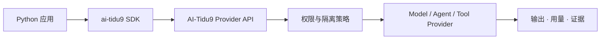

# AI-Tidu9 Python SDK

<p align="center">
  <strong>从 Python 调用 AI-Tidu9 能力，而不是在 Python 中复制控制平面。</strong><br>
  零运行时第三方依赖 · 同步客户端 · 有界 Provider 调用
</p>

[主项目](https://github.com/skillnull/AI-Tidu9) · [使用实例](https://github.com/skillnull/AI-Tidu9/blob/main/docs/EXAMPLES.md) · [开放能力生态](https://github.com/skillnull/AI-Tidu9/blob/main/docs/ECOSYSTEM-SDK.md) · [English](./README.EN.md)

Python SDK 是九门赛博提督能力生态的轻量客户端。策略、权限、隔离、路由和审计仍由 AI-Tidu9 运行时统一执行；Python 进程只负责发起请求并接收结构化结果。



## 📦 要求与安装

- Python 3.10 或更高版本；
- 一个可访问的 AI-Tidu9 运行时；
- SDK 本身只使用 Python 标准库。

从当前仓库安装开发版本：

```bash
python3 -m pip install ./sdk/python
```

> [!NOTE]
> Python SDK 与 `@skillnull/tidu` 使用同步版本元数据。它不是独立控制平面，也不会直接读写 AI-Tidu9 SQLite 或 PostgreSQL。

## 🚀 最短可运行示例

先启动 AI-Tidu9 运行时，再创建客户端：

```python
from ai_tidu9 import TiduClient

client = TiduClient("http://127.0.0.1:9639")

providers = client.list_providers()
result = client.invoke_provider(
    "company.reviewer",
    "review",
    {"text": "Review this bounded change."},
    timeout_ms=10_000,
    maximum_output_bytes=64_000,
)

print(result.output)
print(result.usage)
print(result.evidence)
```

`list_providers()` 只返回当前身份可见的 Provider 元数据。`invoke_provider()` 仍会经过平台权限、信任和隔离检查；发现 Provider 不代表自动获得调用权限。

## 🧭 API 一览

| API | 作用 | 返回值 |
| --- | --- | --- |
| `TiduClient(endpoint, api_key=None, timeout=30)` | 创建同步客户端 | `TiduClient` |
| `list_providers()` | 获取当前可见 Provider | `list[dict]` |
| `invoke_provider(...)` | 在 AI-Tidu9 边界内调用一个能力 | `CapabilityInvocationResult` |

`CapabilityInvocationResult` 包含：

| 字段 | 含义 |
| --- | --- |
| `output` | Provider 的 JSON 兼容输出 |
| `usage` | Provider 返回的可选用量数据，不自动等同于供应商账单 |
| `evidence` | 非敏感、字符串形式的最小证据标识 |

可选调用边界：

- `tenant_id`：把组织边界传递给策略和审计层；
- `timeout_ms`：限制单次能力调用时间；
- `maximum_output_bytes`：限制序列化响应大小。

## 🛡️ 错误处理与安全边界

无效参数抛出 `ValueError`。网络失败、超时、非 JSON 响应或平台拒绝统一抛出 `TiduError`。调用方应捕获错误并决定重试、降级或结束任务，不要假设失败请求可以安全重放。

```python
from ai_tidu9 import TiduClient, TiduError

try:
    result = TiduClient("http://127.0.0.1:9639").invoke_provider(
        "company.reviewer",
        "review",
        {"changeId": "example"},
    )
except TiduError as error:
    print(f"Capability call failed: {error}")
```

- 本机个人版使用回环地址；远程或企业接入必须使用 HTTPS 和身份控制。
- `api_key` 仅在请求时作为 Bearer Token 发送。不要硬编码、记录或提交它。
- SDK 不读取 Codex、Cursor、浏览器或其他宿主的登录凭据。
- 超时不代表服务端一定没有执行。非幂等操作不得盲目重试。

运行 SDK 测试：

```bash
python3 -m unittest discover -s sdk/python/tests
```
